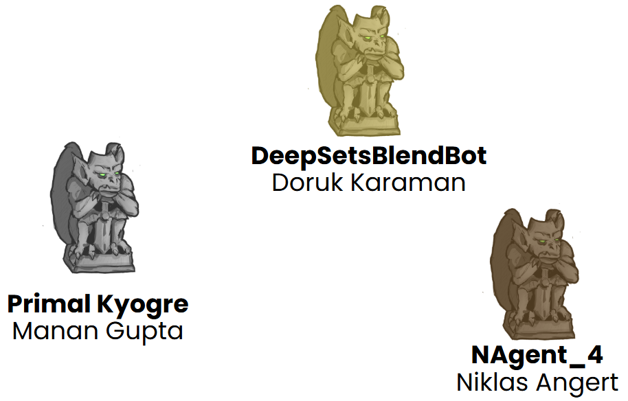
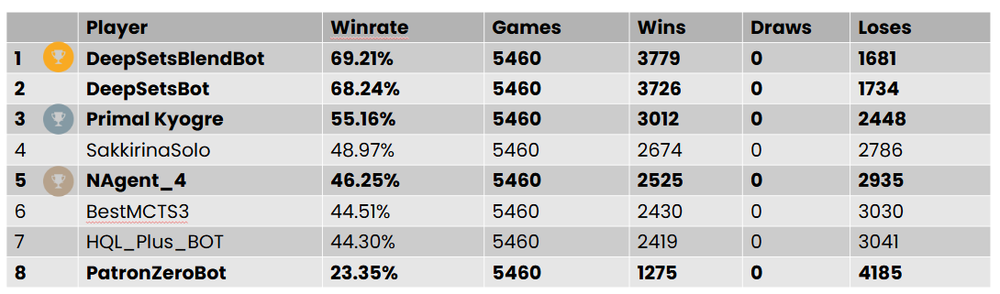
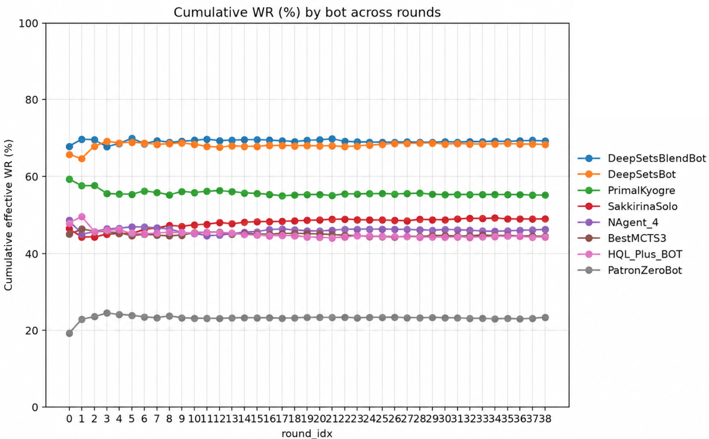
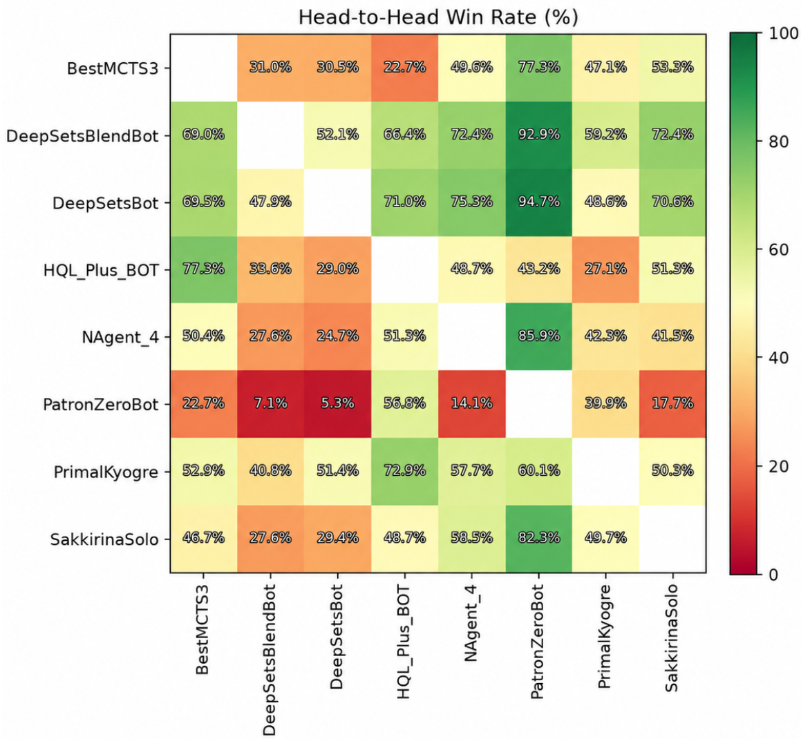

## Tales of Tribute AI Competition at IEEE Conference on Games 2026

Tales of Tribute AI Competition has one of the events at [IEEE Conference on Games 2026](https://cog2026.org/competitions#tales-of-tribute).

The Scripts of Tribute version was [1.1.1](https://github.com/ScriptsOfTribute/ScriptsOfTribute-GUI/releases/tag/v1.1.1) featuring 6 patron decks (Pelin, Crows, Ansei, Rajhin, Orgnum, and Alessia) and  compatible with Tales of Tribute from ESO PC/Mac Patch 10.3.5 (10.03.2025).

The results of the competition were officially presented during the conference: slides are available [here](./slides.pdf).

### Results











### Reproducibility

Download [TournamentRunnerEnv.tar.xz](./TournamentRunnerEnv.tar.xz), then unpack it:

```bash
tar -xJf TournamentRunnerEnv.tar.xz
cd TournamentRunner-main
```

The archive contains the tournament scripts, bot sources, model weights, Q tables,
Docker files, and the Linux x86-64 GameRunner used for the competition. All three
model files are included at the paths expected by the bots; no separate model
download is needed.

Install Docker with Docker Compose v2. The container targets `linux/amd64`;
other architectures need emulation. The Compose configuration allocates 8 CPUs
and up to 24 GB of RAM. The first build needs network access to download images
and dependencies; matches run with networking disabled.

Review `config.yaml` before starting. The archived final configuration uses
39 rounds, 20 games per pair per round, eight bots, and the six competition
patrons. This schedules 21,840 games in total. Keep the patron list unchanged
when rerunning the competition.

Create writable result directories, then build and start the tournament:

```bash
mkdir -p results results-pilot
chmod 0777 results results-pilot
docker compose up --build
```

The archive contains no previous results. A restarted run resumes completed
matches from `results/`. Use an empty results directory when changing the bot
list, patron list, or match settings.

After the tournament ends, generate the summary:

```bash
docker compose run --rm --no-deps tour python summarize_tournament.py
```

Rankings and summary files are written to `results/`; plots are written to
`results/plots/`. Check that `results/completion_report.json` contains
`"complete": true` before treating the ranking as final. You can also run the
summary command during the tournament to inspect progress.

This environment preserves the tournament setup. Dependency downloads and
time-limited, parallel bot searches can affect subsequent runs, so identical
rankings are not guaranteed.

## Archival Call for Participants

<!--
We plan to get back.

More info first quarter of 2026.
-->
<!--
- Submission rules and computational constraints will be similar to the [previous editions](https://github.com/ScriptsOfTribute/ScriptsOfTribute-CompetitionsArchive)
- Update of GUI and Core packages, info about available decks, and balance changes **soon**
--> 

### Important Dates

- **10th August 2026**, 23:59 GMT - **Submission deadline**
- 1st-4th September 2026 - [COG conference](https://cog2026.fdi.ucm.es/index.html) and results announcement


<!--
Tales of Tribute AI Competition has been accepted as one of the events at [IEEE CoG 2025](https://cog2025.inesc-id.pt/tales-of-tribute/).

#### Changes from 2024 edition

- gRPC communication
- Python ScriptsOfTribute library
- Added Saint Alessia deck
- Applied balance changes compatible with latest ESO patch
- Multiple QoL changes for writing and testing agents


### Important Dates

- **10th August 2025**, 23:59 GMT - **Submission deadline**
- 26th-29th August 2025 - [COG conference](https://cog2025.inesc-id.pt/) and results announcement
-->

### Game Updates

- This year, the decks and cards are **exactly the same** as in [2025 edition](https://github.com/ScriptsOfTribute/ScriptsOfTribute-CompetitionsArchive/tree/main/competition-2025-08-COG).
- The goal of this experiment is to allow fair comparison against the previous year's champions.
- However, we ned to emphasize that **to be eligible for prizes, your submission must be substantially different from other non-yours submissions from the previous year**
- Up-to-date core package release is [here](https://github.com/ScriptsOfTribute/ScriptsOfTribute-Core/releases/tag/v1.1.0)
- Up-to-date GUI release package is [here](https://github.com/ScriptsOfTribute/ScriptsOfTribute-GUI-2.0/releases/tag/V1.0_2026) - it allows you to play by hand against the top three bots of the 2025 edition.


### Submission Rules

- Please send a single `.cs` file containing your agent's source code or a zip archive with all the others necessary files to jko@cs.uni.wroc.pl.
- In case of bots made in Python please provide files with source code + `requirements.txt` file archived in zip file.
- In case of agents written in other programming languages please attach compilation/run instructions.
- Additionally, the email should contain:
  - Agent's name.
  - Names (and institutions, if any) of all agent's authors.
  - Short description of the agent. Preferably a few slides or a short note in markdown or PDF; it has to describe what does the agent do, e.g., whether it employs some search algorithms or neural networks.
- Multiple bots can be submitted, but please indicate if a submission should replace an old one or be counted as a new submission (with a different agent's name). Each participant can have up to 2 final submissions. 
- Please be aware that submitted agents are going to be published in this repository after the competition. With the submission, you agree with this procedure.


### Evaluation

Agents will be evaluated using the [SoT-Core Game Runner](https://github.com/ScriptsOfTribute/ScriptsOfTribute-Core), on a large number of mirror matches using randomly generated seeds in an all-play-all system. The deciding factor will be the average winrate.

Evaluation environment will be compatible with the one provided by [Dockerfile](https://github.com/ScriptsOfTribute/ScriptsOfTribute-Core/blob/master/Dockerfile).

Time limit:
- 10 seconds for every turn

Memory limit and other constraints:
- while playing, the bot should not exceed 256 MB of memory. Anytime exceedance of 1024 MB of RAM usage will result in excluding the bot from the contest
- the size of sent file/archive should not exceed 25 MB

<!--
Game version:
- compatible with Tales of Tribute from ESO PC/Mac Patch 10.3.5 (10.03.2025) 
- 6 patrons available: [Pelin](https://eso-hub.com/en/tales-of-tribute/saint-pelin), [Crows](https://eso-hub.com/en/tales-of-tribute/duke-of-crows), [Ansei](https://eso-hub.com/en/tales-of-tribute/ansei-frandar-hunding), [Rajhin](https://eso-hub.com/en/tales-of-tribute/rajhin-the-purring-liar), [Orgnum](https://eso-hub.com/en/tales-of-tribute/sorcerer-king-orgnum), and [Alessia](https://eso-hub.com/en/tales-of-tribute/saint-alessia).
- all decks are assumed to be fully upgraded
-->

### Prizes

<!--We will apply for prizes; more info soon.-->


- $500USD for the first place
- $300USD for the second place
- $200USD for the third place
 
Prizes founded by the [IEEE CIS Education Competition Subcommittee ](https://cis.ieee.org/).


<!--
Prize founded by the [IEEE CIS Education Competition Subcommittee](https://cis.ieee.org/).

-->


## Tales of Tribute AI Competition at IEEE Conference on Games 2026

Tales of Tribute AI Competition has one of the events at [IEEE Conference on Games 2026](https://cog2026.org/competitions#tales-of-tribute).

The Scripts of Tribute version was [1.1.1](https://github.com/ScriptsOfTribute/ScriptsOfTribute-GUI/releases/tag/v1.1.1) featuring 6 patron decks (Pelin, Crows, Ansei, Rajhin, Orgnum, and Alessia) and  compatible with Tales of Tribute from ESO PC/Mac Patch 10.3.5 (10.03.2025).

The results of the competition were officially presented during the conference: slides are available [here](./slides.pdf).

### Results


## Archival Call for Participants

<!--
We plan to get back.

More info first quarter of 2026.
-->
<!--
- Submission rules and computational constraints will be similar to the [previous editions](https://github.com/ScriptsOfTribute/ScriptsOfTribute-CompetitionsArchive)
- Update of GUI and Core packages, info about available decks, and balance changes **soon**
--> 

### Important Dates

- **10th August 2026**, 23:59 GMT - **Submission deadline**
- 1st-4th September 2026 - [COG conference](https://cog2026.fdi.ucm.es/index.html) and results announcement


<!--
Tales of Tribute AI Competition has been accepted as one of the events at [IEEE CoG 2025](https://cog2025.inesc-id.pt/tales-of-tribute/).

#### Changes from 2024 edition

- gRPC communication
- Python ScriptsOfTribute library
- Added Saint Alessia deck
- Applied balance changes compatible with latest ESO patch
- Multiple QoL changes for writing and testing agents


### Important Dates

- **10th August 2025**, 23:59 GMT - **Submission deadline**
- 26th-29th August 2025 - [COG conference](https://cog2025.inesc-id.pt/) and results announcement
-->

### Game Updates

- This year, the decks and cards are **exactly the same** as in [2025 edition](https://github.com/ScriptsOfTribute/ScriptsOfTribute-CompetitionsArchive/tree/main/competition-2025-08-COG).
- The goal of this experiment is to allow fair comparison against the previous year's champions.
- However, we ned to emphasize that **to be eligible for prizes, your submission must be substantially different from other non-yours submissions from the previous year**
- Up-to-date core package release is [here](https://github.com/ScriptsOfTribute/ScriptsOfTribute-Core/releases/tag/v1.1.0)
- Up-to-date GUI release package is [here](https://github.com/ScriptsOfTribute/ScriptsOfTribute-GUI-2.0/releases/tag/V1.0_2026) - it allows you to play by hand against the top three bots of the 2025 edition.


### Submission Rules

- Please send a single `.cs` file containing your agent's source code or a zip archive with all the others necessary files to jko@cs.uni.wroc.pl.
- In case of bots made in Python please provide files with source code + `requirements.txt` file archived in zip file.
- In case of agents written in other programming languages please attach compilation/run instructions.
- Additionally, the email should contain:
  - Agent's name.
  - Names (and institutions, if any) of all agent's authors.
  - Short description of the agent. Preferably a few slides or a short note in markdown or PDF; it has to describe what does the agent do, e.g., whether it employs some search algorithms or neural networks.
- Multiple bots can be submitted, but please indicate if a submission should replace an old one or be counted as a new submission (with a different agent's name). Each participant can have up to 2 final submissions. 
- Please be aware that submitted agents are going to be published in this repository after the competition. With the submission, you agree with this procedure.


### Evaluation

Agents will be evaluated using the [SoT-Core Game Runner](https://github.com/ScriptsOfTribute/ScriptsOfTribute-Core), on a large number of mirror matches using randomly generated seeds in an all-play-all system. The deciding factor will be the average winrate.

The evaluation environment will be compatible with the one provided by [Dockerfile](https://github.com/ScriptsOfTribute/ScriptsOfTribute-Core/blob/master/Dockerfile).

Time limit:
- 10 seconds for every turn

Memory limit and other constraints:
- while playing, the bot should not exceed 256 MB of memory. Anytime exceedance of 1024 MB of RAM usage will result in excluding the bot from the contest
- the size of the sent file/archive should not exceed 25 MB

<!--
Game version:
- compatible with Tales of Tribute from ESO PC/Mac Patch 10.3.5 (10.03.2025) 
- 6 patrons available: [Pelin](https://eso-hub.com/en/tales-of-tribute/saint-pelin), [Crows](https://eso-hub.com/en/tales-of-tribute/duke-of-crows), [Ansei](https://eso-hub.com/en/tales-of-tribute/ansei-frandar-hunding), [Rajhin](https://eso-hub.com/en/tales-of-tribute/rajhin-the-purring-liar), [Orgnum](https://eso-hub.com/en/tales-of-tribute/sorcerer-king-orgnum), and [Alessia](https://eso-hub.com/en/tales-of-tribute/saint-alessia).
- all decks are assumed to be fully upgraded
-->

### Prizes

<!--We will apply for prizes; more info soon.-->


- $500USD for the first place
- $300USD for the second place
- $200USD for the third place
 
Prizes founded by the [IEEE CIS Education Competition Subcommittee ](https://cis.ieee.org/).


<!--
Prize founded by the [IEEE CIS Education Competition Subcommittee](https://cis.ieee.org/).

-->
